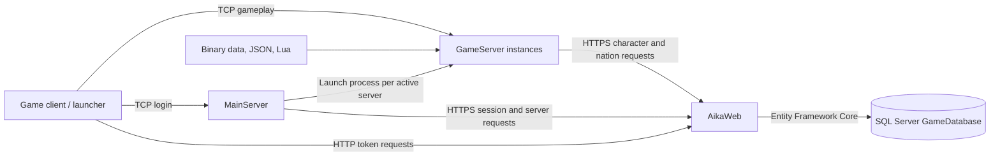

# Architecture

[Documentation index](README.md)

## Components

| Component | Technology | Responsibility | Entry point |
| --- | --- | --- | --- |
| AikaWeb | ASP.NET Core, .NET 6, EF Core SQL Server | HTTP authentication compatibility and database operations | `AikaWeb/Program.cs` |
| LoginServer / MainServer | Windows C++, Winsock, Boost JSON | Login token verification and launch of game instances | `MainServer/Program.cpp` |
| GameServer | Windows C++, Winsock, Boost JSON, Lua | Connected players, in-memory world state, gameplay, and HTTP persistence | `GameServer/Program.cpp` |



Database access is centralized in AikaWeb. The native servers use the shared `GameServer/WebHandler` client, backed by Windows WinHTTP. MainServer compiles several GameServer implementation files directly, including networking, logging, encryption, HTTP, and Windows version helpers.

## Repository map

| Path | Purpose |
| --- | --- |
| `AikaServer.sln` | Visual Studio solution and platform/configuration mappings. |
| `AikaWeb/Controllers/` | Authentication, character, nation, and server HTTP endpoints. |
| `AikaWeb/Models/` | Database record types also exposed as API JSON contracts. |
| `AikaWeb/Data/EntityHandler.cs` | EF Core context. Distinct from the C++ entity registry with the same name. |
| `AikaWeb/Migrations/` | Initial migration, designer metadata, and model snapshot. |
| `MainServer/` | Login connection management, packet handling, startup, and project configuration. |
| `GameServer/` | World entities, controllers, data loaders, packets, and native project configuration. |
| `Database/GameDatabase` | SQL Server backup; inspect its database objects after restoring. |
| `bin/` | Runtime executables, JSON settings, Lua DLL, game data, scripts, and API build outputs. |
| `lib/LuaBridge/` | Bundled LuaBridge headers. |
| `packages/` | Native NuGet dependencies; restore from each native project's `packages.config`. |
| `.github/` | Repository metadata; no executable build/test workflow was found in the analyzed files. |
| `.vs/`, `x64/`, `obj/` | IDE state and build intermediates; not the source of runtime behavior. |

Local experiments and generated artifacts are outside the three-component reference. See the [source inventory](source-inventory.md) for the documented source files.

## Startup

1. SQL Server must provide the expected schema and data.
2. AikaWeb registers the EF context, controllers, and Swagger, then listens for HTTP/HTTPS requests.
3. MainServer calls `GET /servers/all` before starting its login listener. It serializes each returned row, replaces double quotes with single quotes, and invokes Windows `start` with `GameServer.exe` and that JSON argument.
4. Each GameServer parses its launch argument, selects its listening address/port and server type, reads `GameServer.json`, creates its entity registry, and loads runtime content.
5. GameServer opens its socket, loads nation information using `GET /nations/{id}`, starts its accept thread, and starts world routines.
6. MainServer reads `MainServer.json`, opens the login socket, and starts its accept thread.

MainServer is a launcher, with no child-process health supervision or automatic restart in the inspected startup code. A failed server-list request logs `No servers found!`; the login listener can still start. GameServer invokes `SetNationData` without checking its return value, so a listening socket alone does not prove successful nation initialization.

## Login and character selection

```mermaid
sequenceDiagram
    participant C as Client / launcher
    participant W as AikaWeb
    participant L as MainServer
    participant G as GameServer
    participant D as SQL Server
    C->>W: POST member/aika_get_token.asp (id, password)
    W->>D: Compare account credentials; insert Sessions row
    W-->>C: MD5 of SessionID as token
    C->>L: CheckTokenPacket (0x81)
    L->>W: POST /session/data (id, token)
    W->>D: Resolve active session; update status/time
    W-->>L: SessionActiveModel
    L-->>C: ResponseLoginPacket (0x82), account and nation
    C->>G: PacketLoginRequest (0x685)
    G->>W: POST /session/data (id, token)
    W-->>G: SessionActiveModel
    G->>W: Fetch characters and preview equipment
    G-->>C: Character list (0x901)
    C->>G: Numeric token request (0xF02)
    G->>W: Load selected character and related records
    G-->>C: World-entry data
    C->>G: EnterIngame (0xF0B)
    G->>G: Mark Playing and IsIstantiated
```

This sequence documents the server handlers. Client-side server selection and HTTP configuration are not included in this repository. The database-backed `vwSessionsActive` object must resolve the newly created session; see [database limitations](database.md#active-session-object).

## State and persistence

`GameEntity` provides position, character data, status, buffs, visibility, combat, and spawn messages. `Player`, `NPC`, and `Mob` build on it. `EntityHandler` stores raw pointers in an ID-keyed map. Game definitions come from local assets; account and character records come from AikaWeb.

Player disconnect calls `Player::Destroy`, which unspawns the character and saves it while `IsIstantiated` is true. `CharacterController::SaveCharacter` posts character, inventory, skills, hotbar, buffs, titles, and quests sequentially. Each API call saves independently: there is no transaction spanning the complete character snapshot. No periodic full-character autosave routine was found among the world routines.

## Threads

| Loop | Requested sleep after work | Work |
| --- | --- | --- |
| MainServer connection accept | 100 ms | Accept clients and prune inactive connections. |
| MainServer client receive | 100 ms | Receive, decrypt, and dispatch login packets. |
| GameServer connection accept | 100 ms | Allocate players, accept connections, and remove inactive players. |
| GameServer player receive | 1 ms | Receive and dispatch player packets. |
| Visibility update | 10 ms | Evaluate visible entities for instantiated players. |
| Buff/status update | 100 ms | Recalculate buffs, regeneration, and damage over time. |
| Mob actions | 100 ms | Update movement, attacks, death, and respawn. |
| Quest evaluation | 2,000 ms | Evaluate quest state for instantiated players. |

These are sleep durations, not fixed tick frequencies: blocking socket and HTTP work adds latency. Most threads are detached. Some registry mutations use mutexes, but `GetEntities()` returns a mutable reference after releasing its lock. Concurrent iteration and lifetime changes require care; the implementation does not establish a globally synchronized world update.
