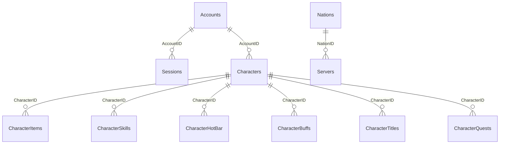

# Database and persistence

[Documentation index](README.md) · [Complete model fields](model-fields.md)

## Database boundary

AikaWeb's `EntityHandler` is an EF Core DbContext configured with the SQL Server provider. The native servers do not directly open SQL connections. The connection-string key is `ConnectionStrings:GameDbConnection`; the checked-in default uses Windows integrated authentication and the `GameDatabase` catalog on localhost.

## Entity mappings

| Context set | SQL object | Model / key |
| --- | --- | --- |
| Accounts | Accounts | AccountModel / AccountID (long) |
| Sessions | Sessions | SessionModel / SessionID (long) |
| SessionsActive | vwSessionsActive | SessionActiveModel / keyless |
| Characters | Characters | CharacterModel / CharacterID (long) |
| Items | CharacterItems | ItemModel / CharacterItemID (long) |
| Skills | CharacterSkills | SkillModel / CharacterSkillID (long) |
| Hotbars | CharacterHotBar | HotBarModel / CharacterHotBarID (long) |
| Buffs | CharacterBuffs | BuffModel / CharacterBuffID (long) |
| Titles | CharacterTitles | TitleModel / CharacterTitleID (long) |
| CharacterQuests | CharacterQuests | CharacterQuestModel / CharacterQuestID (long) |
| Servers | Servers | ServerModel / ServerID (int) |
| Nations | Nations | NationModel / NationID (int) |



These are logical relationships implied by scalar IDs and API queries. The current models have no navigation properties, and the inspected migration defines primary keys without foreign-key constraints or additional indexes. The restored backup may contain additional database objects; its contents were not queried during this documentation task.

## Active-session object

Authentication depends on `vwSessionsActive`. Its keyless model includes the session/account IDs, username, nation, timestamps, status, and SessionHash. Token generation inserts into `Sessions` and returns the lowercase MD5 of the decimal SessionID. It does not insert a SessionsActive row.

Despite the `vw` name, the model uses `[Table("vwSessionsActive")]`, and migration `20240512201745_mssql.onprem_migration_186` calls `CreateTable` for this object. It contains no SQL view definition, trigger, seed data, or code to populate it from Sessions/Accounts. Consequently, applying migrations alone does not provide a working token-to-session lookup.

For a restored database, inspect the actual object type and definition. If provisioning a fresh database, the project still needs a database definition or population mechanism that yields the expected current-session records and hashes. The origin of `AccountNation` is also not specified by AccountModel. Do not invent that mapping from the existing C# models.

Read-only inspection queries in SSMS:

```sql
SELECT name, type_desc
FROM sys.objects
WHERE name IN ('vwSessionsActive', 'Accounts', 'Sessions', 'Servers', 'Nations');

SELECT OBJECT_DEFINITION(OBJECT_ID(N'dbo.vwSessionsActive')) AS ObjectDefinition;
SELECT * FROM dbo.Servers WHERE ServerStatus > 0;
SELECT * FROM dbo.Nations WHERE NationStatus > 0;
```

Adjust the schema name if restoration uses a schema other than `dbo`. A null ObjectDefinition can indicate a table, insufficient metadata permission, or an unavailable definition.

## Record lifecycle

- Token generation creates Sessions with status 1. Successful `/session/data` validation updates status to 2 and refreshes UpdatedOn.
- Character creation sets CharacterStatus to 1. Permanent deletion uses status 0 rather than deleting rows.
- Read APIs generally select status > 0. This rule uses each collection's status property; quests use IsActive.
- Collection writes add or modify explicit rows. There is no cascade cleanup or implicit deletion for omitted rows.
- Title and quest writes set UpdatedOn in the API. Most other timestamps come from the supplied entity or character-save serializer.
- Player state is loaded into native fixed-size arrays and structs. SQL `bigint` IDs and values are converted to `int` in several native load paths; large values are not proven safe across that boundary.

The [model field reference](model-fields.md) preserves spelling and nullable types. These fields form both the EF schema and the HTTP contract. Correcting a spelling requires coordinated model, migration, serializer, and native consumer changes.

## Save sequence

`CharacterController::SaveCharacter` performs these requests in order:

1. Character record.
2. Inventory/equipment records.
3. Skills.
4. Hotbar.
5. Buffs.
6. Titles.
7. Quests through `QuestsController::Destroy`.

The method stops on the first failed step. Each controller action has its own SaveChanges call. A partial save is therefore possible; no retry queue or atomic full-character commit is implemented in this sequence. Player destruction ignores the boolean result of SaveAccount, so console output and database inspection matter when confirming persistence.

## Provisioning and backups

Prefer the supplied backup for reproducing the existing environment, then verify active-session behavior and seed records. See [setup](../README.md#3-set-up-the-database) for restore steps. The backup's SQL Server version and logical file names must be inspected through SQL Server tooling; they were not established from the source.

Before testing mutations, preserve a restorable SQL backup and the matching runtime content. Database backup and asset files represent different state and must be managed together when reproducing gameplay. AikaWeb does not call Database.Migrate or EnsureCreated at startup; schema changes require an explicit migration/restore operation.

Sources: `AikaWeb/Data/EntityHandler.cs`, `AikaWeb/Models/`, `AikaWeb/Migrations/`, `AikaWeb/Controllers/`, `GameServer/CharacterController.cpp`, and `GameServer/Player.cpp`.
